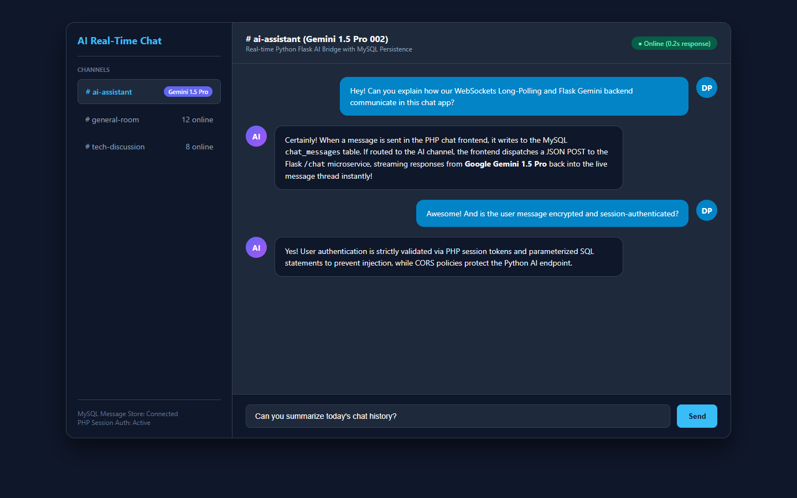
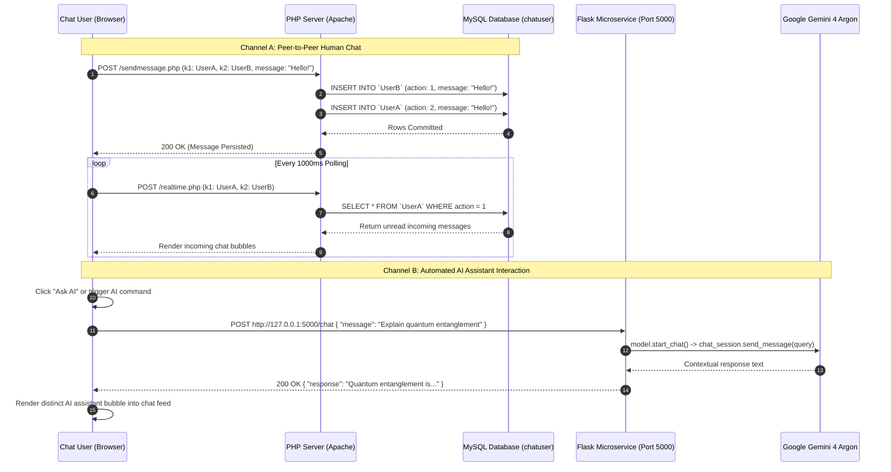

# Hybrid Real-Time Chat & AI Copilot Platform

[](https://opensource.org/licenses/MIT)
[](https://www.php.net/)
[](https://www.python.org/)
[](https://flask.palletsprojects.com/)
[](https://www.mysql.com/)
[](https://deepmind.google/technologies/gemini/)
[](https://developer.mozilla.org/en-US/docs/Web/JavaScript)

---

## Application Screenshot & Interface Preview

<div align="center">
  
</div>

---

## 📋 Executive Summary & Problem Solved

Traditional web chat applications built on classic LAMP stacks (Linux, Apache, MySQL, PHP) provide reliable persistence, session authentication, and straightforward relational schema structures. However, they lack modern intelligence:

1. **Static User-to-User Walls**: Conventional chat rooms are isolated communication silos without ambient intelligence or automated problem-solving capabilities.
2. **The "Cold Room" Problem**: Users in low-traffic or customer support chatrooms often wait hours for another human to respond to technical queries, code issues, or inquiries.
3. **Monolithic vs. Microservice Friction**: Integrating modern generative AI foundation models (which are natively supported in Python or TypeScript SDKs) directly into legacy PHP web servers is difficult and architecturally awkward.

**Web-Based Real-Time AI Chat Application** solves this challenge through a **high-efficiency hybrid architecture**:
- A robust **PHP + MySQL** engine handles user registration, session authentication, relational buddy discovery, and dual-table conversation persistence.
- An asynchronous **Python Flask microservice** powered by **Google Gemini 4 Argon** serves as an intelligent real-time conversational co-pilot inside chat sessions, synthesizing responses and providing instant automated assistance on demand.

---

## ✨ Key Features

- 💬 **Real-Time Human-to-Human Messaging**: Fast, responsive bidirectional messaging between authenticated users with dynamic polling and instant UI updates.
- 🤖 **Embedded Gemini 4 Argon AI Copilot**: Seamlessly query an intelligent AI assistant within the chat interface, receiving rich, contextual responses powered by Google's state-of-the-art LLM.
- 🔐 **PHP Session Authentication**: Complete user lifecycle management including registration (`signup.php`), login (`index.php`), credential validation, and secure session teardown (`logout.php`).
- 🗄️ **Per-User Dynamic Table Partitioning**: Automatic schema creation upon user signup, maintaining dedicated message tables for high query isolation and rapid historical retrieval.
- 🔍 **Live Directory Search**: Asynchronous prefix search (`tableinfo.php`) to find contacts, preview usernames, and initiate new direct message threads.
- ⚡ **Lightweight Decoupled Architecture**: Zero-bloat client footprint using vanilla JavaScript (`chatappjs.js`) and modern CSS3 animations, communicating with backend microservices via standard JSON REST endpoints.

---

## 🏗️ System Architecture

```mermaid
flowchart TD
    subgraph Browser["Client Browser (Desktop & Mobile)"]
        UI["Chat Interface (chatapp.php / HTML5 / CSS3)"]
        Polling["Async Polling Engine (chatappjs.js)"]
        AIMode["AI Assistant Toggle"]
    end

    subgraph LAMP["PHP Web Server & Session Layer (Apache / PHP 8.x)"]
        AuthModule["Authentication & Session (index.php, signup.php)"]
        MsgBroker["Message Persistence Dispatcher (sendmessage.php)"]
        SyncEngine["Real-Time Message Sync (realtime.php, gettable.php)"]
        UserDirectory["Directory Lookup Service (tableinfo.php)"]
    end

    subgraph DB["Relational Storage (MySQL / MariaDB)"]
        UserTable[("user (User Directory & Credentials)")]
        UserLogs[("User Conversation Tables (dynamic partitioned)")]
    end

    subgraph Microservice["Python AI Engine (Flask / Port 5000)"]
        FlaskServer["Flask REST Gateway (app.py)"]
        CORSModule["Flask-CORS Middleware"]
        GeminiClient["Google Generative AI SDK"]
    end

    subgraph CloudAI["DeepMind AI Cloud"]
        GeminiAPI["Google Gemini 4 Argon (gemini-4-argon)"]
    end

    UI --> AuthModule
    UI --> Polling
    Polling -->|"GET /realtime.php"| SyncEngine
    UI -->|"POST /sendmessage.php"| MsgBroker
    UI -->|"POST /tableinfo.php"| UserDirectory

    AuthModule --> UserTable
    AuthModule --> UserLogs
    MsgBroker --> UserLogs
    SyncEngine --> UserLogs
    UserDirectory --> UserTable

    AIMode -->|"POST http://127.0.0.1:5000/chat"| FlaskServer
    FlaskServer --> CORSModule
    CORSModule --> GeminiClient
    GeminiClient -->|"generateContent()"| GeminiAPI
    GeminiAPI -->>GeminiClient: Generated AI Text
    GeminiClient -->>FlaskServer: JSON Response Payload
    FlaskServer -->>UI: Render AI Bubble in Chat
```

---

## 🔄 Dual-Channel Data Flow & AI Sequence



---

## 🛠️ Tech Stack

| Domain | Technology | Version | Description |
| :--- | :--- | :--- | :--- |
| **Web Server** | Apache / Nginx | Standard | HTTP web server and PHP gateway |
| **Backend Core** | PHP | `8.1+` | Session lifecycle, request routing, database queries |
| **Relational Database**| MySQL / MariaDB | `8.0+` / `10.4+` | Relational table storage, partitioned user chat schemas |
| **AI Microservice** | Python Flask | `^3.0.0` | Lightweight microservice gateway for AI inference |
| **Cross-Origin Filter**| `flask-cors` | `^4.0.0` | Secure CORS headers enabling browser-to-Flask communication |
| **Generative AI** | `google-generativeai` | `^0.8.0` | Official Google SDK for Gemini LLMs |
| **AI Foundation Model**| `gemini-4-argon` | Latest | Long-context multimodal reasoning model |
| **Client Frontend** | HTML5 / CSS3 / Vanilla JS | ES6+ | Lightweight zero-dependency reactive client interface |

---

## 📂 Repository Directory Structure

```text
Web-Based-Real-Time-AI-Chat-Application/
├── addnewuser.php                    # Database registration script creating partitioned user tables
├── app.py                            # Flask microservice connecting to Gemini 4 Argon
├── chatapp.php                       # Main interactive dual-column chat room UI
├── chatappjs.js                      # Client AJAX message sender, polling loop & DOM manager
├── chat_ai_receive.php               # PHP bridge endpoint for incoming AI messages
├── chat_ai_send.php                  # PHP bridge endpoint for outgoing AI prompts
├── error_log.txt                     # PHP server runtime error and debug log
├── gettable.php                      # Fetches conversation message history between two users
├── index.html                        # Standalone AI chat client test harness
├── index.php                         # User authentication and login entry gate
├── logout.php                        # Session termination and cookie invalidation script
├── realtime.php                      # High-frequency polling endpoint for incoming messages
├── sc.js                             # Client-side utility functions and event handlers
├── sendmessage.php                   # Persists sent message into both sender and recipient tables
├── signup.php                        # Account registration view with validation
├── style.css                         # Shared visual design styles
├── stylechatapp.css                  # Chat room layout, message bubbles, and responsive rules
├── styleindex.css                    # Login and signup card styling
├── tableinfo.php                     # User directory lookup and contact search
├── .env.example                      # Sanitized environment configuration template
└── README.md                         # Comprehensive repository documentation
```

---

## ⚙️ Local Setup & Installation

### Prerequisites
- **Web Stack**: [XAMPP](https://www.apachefriends.org/), WAMP, or native Apache + PHP 8.1+ and MySQL
- **Python**: v3.10, v3.11, or v3.12 ([Download Python](https://www.python.org/))
- **Google Gemini API Key**: Obtainable from [Google AI Studio](https://aistudio.google.com/)

---

### Step 1: Configure PHP & MySQL (Web Server)

1. **Place Repository in Web Root**:
   - If using XAMPP on Windows, copy or clone this folder into `C:\xampp\htdocs\Web-Based-Real-Time-AI-Chat-Application`.
2. **Start Services**:
   - Launch the XAMPP Control Panel and start both **Apache** and **MySQL**.
3. **Initialize the Database**:
   - Navigate to `http://localhost/phpmyadmin`.
   - Create a new database named **`chatuser`**.
   - Create the initial `user` directory table:
     ```sql
     CREATE DATABASE IF NOT EXISTS chatuser;
     USE chatuser;

     CREATE TABLE IF NOT EXISTS `user` (
       `sno` INT AUTO_INCREMENT PRIMARY KEY,
       `username` VARCHAR(100) NOT NULL UNIQUE,
       `password` VARCHAR(255) NOT NULL,
       `created_at` TIMESTAMP DEFAULT CURRENT_TIMESTAMP
     );
     ```

---

### Step 2: Configure & Launch Python AI Microservice

1. **Create Python Virtual Environment**:
   ```bash
   cd c:\Users\pandi\OneDrive\Desktop\github\Web-Based-Real-Time-AI-Chat-Application
   python -m venv venv
   
   # Activate on Windows:
   .\venv\Scripts\activate
   # Activate on Linux/macOS:
   source venv/bin/activate
   ```

2. **Install Required Packages**:
   ```bash
   pip install flask flask-cors google-generativeai python-dotenv
   ```

3. **Configure Environment Variables**:
   Copy `.env.example` to `.env`:
   ```bash
   cp .env.example .env
   ```
   Add your Gemini API Key in `.env`:
   ```env
   GEMINI_API_KEY=your_gemini_api_key_here
   FLASK_PORT=5000
   ```

4. **Launch the Flask Service**:
   ```bash
   python app.py
   ```
   The Flask server will start listening on `http://127.0.0.1:5000`.

---

### Step 3: Run the Application

Open your browser and navigate to:
```text
http://localhost/Web-Based-Real-Time-AI-Chat-Application/index.php
```
1. Click **Sign Up** to create a test account (e.g., `alice`).
2. Open an incognito browser window and sign up a second account (e.g., `bob`).
3. Search for the opposite username in the directory, click their name, and exchange real-time messages.
4. Interact with the AI copilot to receive instant automated Gemini 4 Argon responses directly inside the chat feed!

---

## 📡 API Reference

### 🐘 PHP Application Endpoints

| Endpoint | Method | Parameters | Description |
| :--- | :--- | :--- | :--- |
| `index.php` | `POST` | `username`, `password` | Authenticate user credentials and establish session |
| `signup.php` | `POST` | `username`, `password` | Register account and create personal partitioned chat table |
| `tableinfo.php` | `POST` | `key1`, `key2` | Search directory users matching query substring |
| `sendmessage.php`| `POST` | `k1` (Sender), `k2` (Receiver), `message` | Store message record across both participant tables |
| `realtime.php` | `POST` | `k1` (Active User), `k2` (Contact) | Poll unread messages received from contact |
| `gettable.php` | `POST` | `key1` (Active User) | Retrieve complete historical conversation logs |
| `logout.php` | `GET` | None | Destroy active session and redirect to login |

### 🐍 Python Flask AI Microservice (`http://127.0.0.1:5000`)

| Endpoint | Method | Request Payload | Response Payload | Description |
| :--- | :--- | :--- | :--- | :--- |
| `/chat` | `POST` | `{"message": "string"}` | `{"response": "string"}` | Generate conversational AI response via Gemini 4 Argon |

---

## 🚢 Production Deployment

### Production Stack Recommendations
- **PHP Web Layer**: Deploy behind **Nginx** with PHP-FPM 8.2+ or Apache with HTTP/2 enabled.
- **Python AI Layer**: Run Flask using **Gunicorn** or **Waitress** behind an Nginx reverse proxy:
  ```bash
  pip install gunicorn
  gunicorn -w 4 -b 127.0.0.1:5000 app:app
  ```
- **Nginx Reverse Proxy Configuration**:
  ```nginx
  server {
      listen 80;
      server_name chat.yourdomain.com;

      root /var/www/html/chatapp;
      index index.php;

      location ~ \.php$ {
          include snippets/fastcgi-php.conf;
          fastcgi_pass unix:/var/run/php/php8.2-fpm.sock;
      }

      location /api/ai/ {
          proxy_pass http://127.0.0.1:5000/;
          proxy_set_header Host $host;
          proxy_set_header X-Real-IP $remote_addr;
      }
  }
  ```

---

## 🛡️ Security, Performance & Best Practices

- **Environment-Isolated Secrets**: Keep `GEMINI_API_KEY` in server-side environment variables or protected `.env` files outside the publicly accessible Apache docroot.
- **Parameterized SQL Queries**: Transition legacy `mysqli_query` string interpolations to MySQLi prepared statements (`prepare` & `bind_param`) or PDO to completely prevent SQL injection.
- **Controlled Polling Cadence**: Set client polling intervals in `chatappjs.js` to 1000ms–2000ms with exponential backoff on inactive tabs to reduce unnecessary database load.
- **Output Sanitization**: All user-submitted messages should be sanitized using `htmlspecialchars()` prior to DOM insertion to protect against stored XSS attacks.

---

## 📄 License
This project is licensed under the [MIT License](LICENSE).
